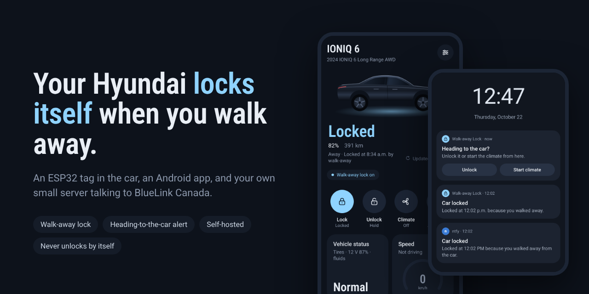
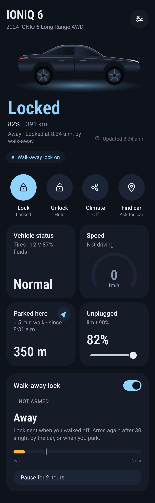
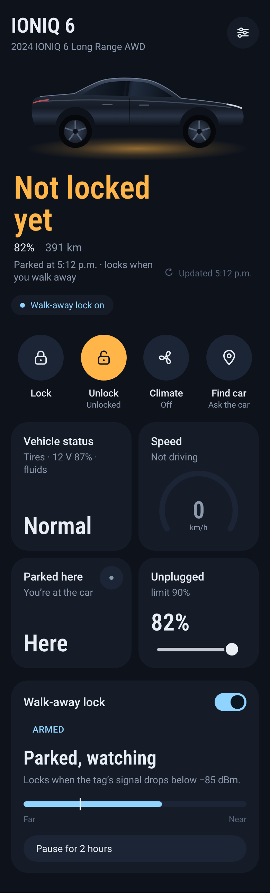
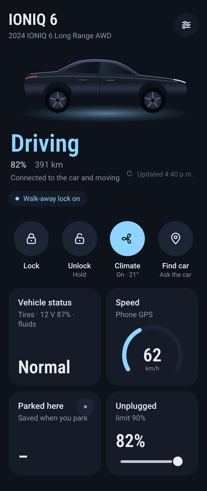
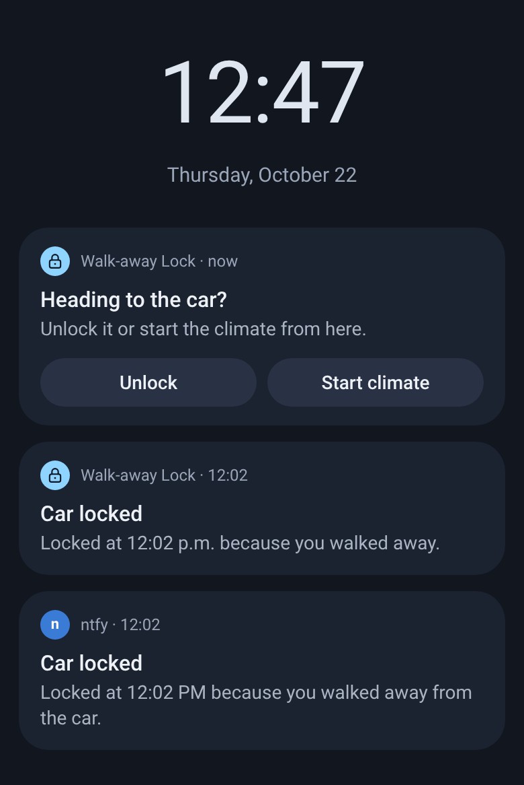
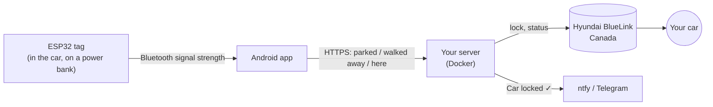

<p align="center">
  
</p>

<p align="center">
  <a href="https://github.com/ishmeetahuja/ioniq6-api/actions/workflows/build.yml"></a>
  <a href="https://github.com/ishmeetahuja/ioniq6-api/releases/latest"></a>
  
  
  <a href="LICENSE"></a>
</p>

# Walk-away Lock for Hyundai BlueLink (Canada)

Hyundai's IONIQ 6 has no walk-away auto-lock. This project adds one, with parts you may already have
or can buy for about $10–25:

- a **tiny ESP32 board** in the car, running off a USB power bank, acting as a Bluetooth "tag";
- an **Android app** that watches the tag's signal and knows when you've walked away;
- your **own small server** (a Raspberry Pi, a NAS, Unraid, or a $5 cloud box) that sends the
  lock command through Hyundai BlueLink Canada and pings your phone when it's done.

You park, you walk away, your phone buzzes, the car is locked. Walk back after lunch and your
phone asks *"Heading to the car?"* with **Unlock** and **Start climate** buttons.

> [!IMPORTANT]
> **It never unlocks anything by itself.** Unlocking always takes your tap: press and hold in the
> app, or from a notification, which asks for your phone's fingerprint or PIN first. The phone's token can lock, but can't unlock or start
> the car.

## Screens

<table>
  <tr>
    <td align="center"><br><sub><b>Locked after you walked away</b></sub></td>
    <td align="center"><br><sub><b>Parked and armed</b>: the bar is the tag's signal</sub></td>
    <td align="center"><br><sub><b>Driving</b>: speed from the phone's GPS</sub></td>
    <td align="center"><br><sub><b>Alerts</b>: lock confirmations and the walk-up prompt</sub></td>
  </tr>
</table>

## What it does

| | |
|---|---|
| 🔒 **Walk-away lock** | Locks when the tag's signal fades as you leave. Your phone buzzes and says why. |
| 🏠 **Home mode** | At home (your Wi-Fi or a spot on the map) the tag reaches the house, so instead it locks once per visit, a set time after you leave the car (60 s by default). |
| 🚶 **Heading to the car?** | Away for 5+ minutes, then walking back: one alert with Unlock / Start climate, while you're still walking up. |
| 🛟 **Safety nets** | If your phone dies or loses signal after you park, the server locks on its own after 10 minutes. A gentle backup check every 6 hours catches anything else. |
| 🎛️ **Car controls** | Lock, Unlock (press and hold), Climate, Charging limits, Find car, Vehicle status. |
| 📍 **Parked here** | Where you left the car, how far it is, and an arrow pointing to it. From your phone's GPS; nothing is sent to Hyundai. |
| 🔔 **Notifications** | Every lock goes to [ntfy](https://ntfy.sh) (or Telegram) with the reason, so you have a record. |
| 🐢 **Easy on Hyundai** | Hyundai rate-limits sign-ins and car wake-ups. The server batches, caches and backs off so you stay well under the limits. |

## How it works



The phone does the deciding, because it's the thing that walks away with you and always has
internet. The tag needs no Wi-Fi. The server holds your BlueLink login, talks to Hyundai, and keeps
a few safety nets running. More detail: [How it works](docs/how-it-works.md).

## What you need

- A **Hyundai with BlueLink in Canada** (mybluelink.ca). Built and tested on an IONIQ 6; lock,
  climate and status should work on other BlueLink Canada models too.
- An **Android phone**, Android 12 or newer.
- An **ESP32 board** (classic ESP32, ESP32-C3 or ESP32-S3, about $6–15) and a **USB power bank**
  that doesn't switch itself off at low current. See [Hardware](docs/1-hardware.md).
- A computer that's **always on and can run Docker**: Raspberry Pi 4/5, a NAS, Unraid, an old
  PC, or a small cloud server. It needs to be reachable over HTTPS (one port forward at home).

## Get started

You run every piece yourself. There is no shared server and no shared BlueLink login. The password
stays in a file on the computer you pick. Nothing here is pre-filled with someone else's car,
server or token: the app starts empty, and the server reads `server/.env` (copy
[`server/.env.example`](server/.env.example)).

### 1. Flash the ESP32 tag

Any classic ESP32, ESP32-C3 or ESP32-S3 (about $6–15) and a USB power bank that stays on under a
very small load.

**In the browser:** open the [one-click flasher](https://ishmeetahuja.github.io/ioniq6-api/) in
Chrome or Edge, plug the board in with a **data** USB cable, click **Connect & install** and pick
the port. What to buy, and what to do when a power bank switches itself off:
[Hardware](docs/1-hardware.md).

**From a release:** download `esp32-car-tag.bin`, `esp32c3-car-tag.bin` or `esp32s3-car-tag.bin`
from the [latest release](https://github.com/ishmeetahuja/ioniq6-api/releases/latest) and flash it
at address **0x0**. The same files are attached to the **Build** workflow as the `firmware`
artifact. A Bluetooth scan then shows **`WALKAWAY-TAG`**.

**Build it yourself:**

```bash
pip install platformio "esptool<5"
pio run -d firmware -e esp32dev -t upload    # or -e esp32c3 / -e esp32s3
```

Put the board in the glovebox or centre console, then plug it in: car USB → power bank → ESP32.

### 2. Run your own server

This is the part that talks to Hyundai. A Raspberry Pi, a NAS, Unraid or a small Linux computer is
enough. It has to be reachable on HTTPS (TCP 443; port 80 as well if you can).

```bash
curl -fsSL https://get.docker.com | sudo sh
sudo docker run --rm ghcr.io/ishmeetahuja/ioniq6-api/server cat /app/install.sh > install.sh && sudo bash install.sh
```

It asks for a hostname (press Enter and it uses a free `<your-ip>.sslip.io` name), then your
BlueLink email, password and 4-digit PIN, then the one-time code Hyundai sends you. At the end it
prints the **server address** and the **phone token**. The **admin token**, which is allowed to
unlock, is only in `/opt/ioniq6/.env` on that machine (`/mnt/user/appdata/ioniq6/.env` on Unraid).

Port forwarding, Unraid, and updating: [Server](docs/2-server.md).

### 3. Install the Android app

Android 12 or newer. The public application id is `io.github.ishmeetahuja.walkawaylock` and the
name on the home screen is **Walk-away Lock** ([`config/public.properties`](config/public.properties)).
It installs beside any other build that uses a different id.

1. On your phone, open the [latest release](https://github.com/ishmeetahuja/ioniq6-api/releases/latest)
   and install **`walkaway-lock.apk`**. `SHA256SUMS.txt` in the same release is the checksum.
   `walkaway-lock.aab` is the Android App Bundle for a Play upload; a phone installs the APK.
   Both files are also artifacts of the **Build** workflow.
2. Or add `https://github.com/ishmeetahuja/ioniq6-api` in [Obtainium](https://github.com/ImranR98/Obtainium)
   and let it install new releases.
3. Open the app, tap the settings button, and enter the **server address** and **phone token**.
   Tap **Save and test**. The phone token can lock the car. It cannot unlock, start climate or
   read the car's location.
4. For **Unlock**, **Climate**, **Charging** and **Find car**, also paste the admin token.
   Unlock is a press-and-hold. From a notification, the phone asks for your fingerprint or PIN first.
5. Pick your car's Bluetooth device, then **Find** the tag with it powered and nearby.
6. Allow the app to ignore battery optimisation. For home detection, allow location all the time
   and set your home Wi-Fi or your home spot. Those stay on the phone.
7. Stand where you want the lock to happen, tap **Use current signal**, turn **Walk-away lock**
   on, and walk away.

Permissions and the settings screens: [App](docs/3-app.md). Calibrating: [Using it](docs/4-using.md).

### iPhone

There is no iOS project in this repository yet, so there is no TestFlight build to join. The
upload workflow is ready (`.github/workflows/testflight.yml`): once a public Xcode project is
added at `ios/WalkawayLock.xcodeproj` and the maintainer's App Store Connect secrets are set, it
uploads to TestFlight under the bundle id `io.github.ishmeetahuja.walkawaylock`. A properly signed
TestFlight build can watch Bluetooth in the background. The public TestFlight link will be added
to this page when that first build exists. What the maintainer has to create is listed in
[CONTRIBUTING.md](CONTRIBUTING.md). It is not created in the repository.

Something not working? [Troubleshooting](docs/troubleshooting.md) · [FAQ](docs/faq.md)

## Good to know

- **Canada only.** BlueLink in the US and Europe uses different APIs. Help adding them is welcome.
- **Android is what you can install today.** The iOS TestFlight workflow is in the repo; the iOS
  app itself is not, so there is nothing to install on an iPhone until a build is uploaded.
- **Not on the Play Store.** Install the APK from [Releases](https://github.com/ishmeetahuja/ioniq6-api/releases),
  or let [Obtainium](https://github.com/ImranR98/Obtainium) keep it updated for you.
- **Your login stays with you.** Your BlueLink password lives only on your server. Nothing goes
  to the author or anyone else. See [Privacy](PRIVACY.md).

## Disclaimer

This is an independent hobby project. It is **not affiliated with, endorsed by or supported by
Hyundai**. It uses BlueLink's unofficial web API, which can change or stop working at any time, and
automated use may go against BlueLink's terms. It's a convenience, not a security system: you're
still responsible for your car. Software is provided as is, without warranty (see [LICENSE](LICENSE)).
"Hyundai", "BlueLink" and "IONIQ" are trademarks of their owners and are used here only to say
what this works with.

## Credits and licence

The BlueLink Canada protocol was ported from
[hyundai_kia_connect_api](https://github.com/Hyundai-Kia-Connect/hyundai_kia_connect_api). Thank you
to everyone who works out and documents these APIs.

[GPL-3.0](LICENSE). Use it, change it, share it; if you share a changed version, share its source
too. Contributions welcome: see [CONTRIBUTING.md](CONTRIBUTING.md).
