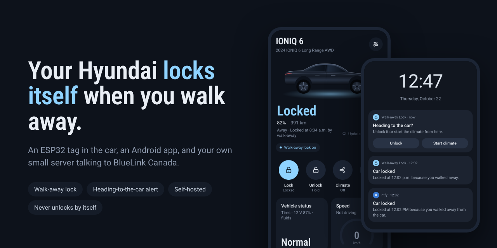
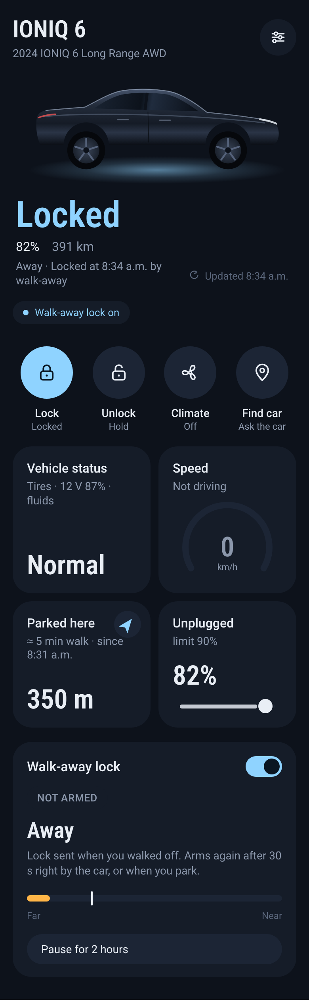
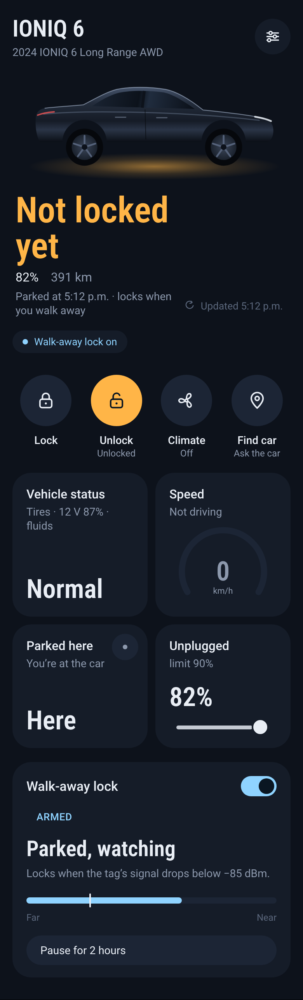
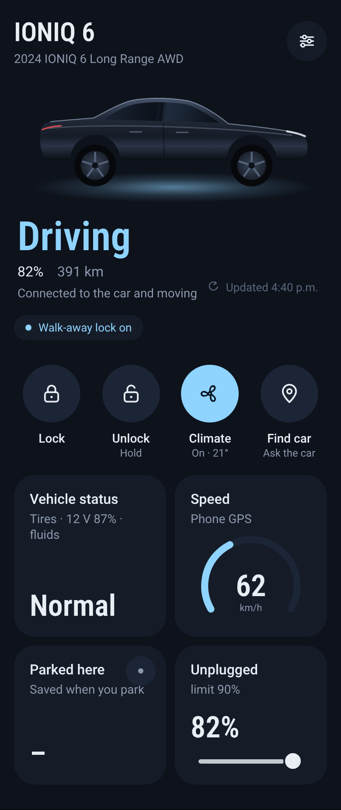
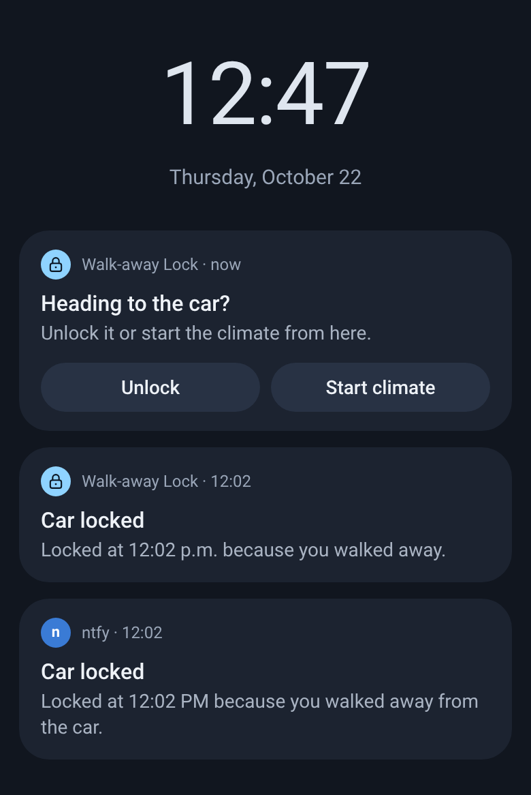
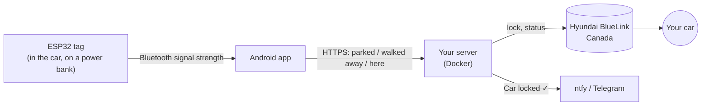

  

  
  
  
  
  

# Walk-away Lock for Hyundai BlueLink (Canada)

Hyundai's IONIQ 6 has no walk-away auto-lock. This project adds one, with parts you may already have
or can buy for about $10–25:

- a **tiny ESP32 board** in the car, running off a USB power bank, acting as a Bluetooth "tag";
- an **Android app** that watches the tag's signal and knows when you've walked away;
- your **own small server** (a Raspberry Pi, a NAS, Unraid, or a $5 cloud box) that sends the
  lock command through Hyundai BlueLink Canada and pings your phone when it's done.

You park, you walk away, your phone buzzes, the car is locked. Walk back after lunch and your
phone asks *"Heading to the car?"* with **Unlock** and **Start climate** buttons.

> [!IMPORTANT]
> **It never unlocks anything by itself.** Unlocking always takes your tap: press and hold in the
> app, or from a notification, which asks for your phone's fingerprint or PIN first. The phone's token can lock, but can't unlock or start
> the car.

## Screens

<table>
  <tr>
    <td align="center"> <b>Locked after you walked away</b></td>
    <td align="center"> <b>Parked and armed</b>: the bar is the tag's signal</td>
    <td align="center"> <b>Driving</b>: speed from the phone's GPS</td>
    <td align="center"> <b>Alerts</b>: lock confirmations and the walk-up prompt</td>
  </tr>
</table>

## What it does

| | |
|---|---|
| 🔒 **Walk-away lock** | Locks when the tag's signal fades as you leave. Your phone buzzes and says why. |
| 🏠 **Home mode** | At home (your Wi-Fi or a spot on the map) the tag reaches the house, so instead it locks once per visit, a set time after you leave the car (60 s by default). |
| 🚶 **Heading to the car?** | Away for 5+ minutes, then walking back: one alert with Unlock / Start climate, while you're still walking up. |
| 🛟 **Safety nets** | If your phone dies or loses signal after you park, the server locks on its own after 10 minutes. A gentle backup check every 6 hours catches anything else. |
| 🎛️ **Car controls** | Lock, Unlock (press and hold), Climate, Charging limits, Find car, Vehicle status. |
| 📍 **Parked here** | Where you left the car, how far it is, and an arrow pointing to it. From your phone's GPS; nothing is sent to Hyundai. |
| 🔔 **Notifications** | Every lock goes to [ntfy](https://ntfy.sh) (or Telegram) with the reason, so you have a record. |
| 🐢 **Easy on Hyundai** | Hyundai rate-limits sign-ins and car wake-ups. The server batches, caches and backs off so you stay well under the limits. |

## How it works

The phone does the deciding, because it's the thing that walks away with you and always has
internet. The tag needs no Wi-Fi. The server holds your BlueLink login, talks to Hyundai, and keeps
a few safety nets running. More detail: [How it works](docs/how-it-works.md).

## What you need

- A **Hyundai with BlueLink in Canada** (mybluelink.ca). Built and tested on an IONIQ 6; lock,
  climate and status should work on other BlueLink Canada models too.
- An **Android phone**, Android 12 or newer.
- An **ESP32 board** (classic ESP32, ESP32-C3 or ESP32-S3, about $6–15) and a **USB power bank**
  that doesn't switch itself off at low current. See [Hardware](docs/1-hardware.md).
- A computer that's **always on and can run Docker**: Raspberry Pi 4/5, a NAS, Unraid, an old
  PC, or a small cloud server. It needs to be reachable over HTTPS (one port forward at home).

## Get started

1. **[Flash the tag](docs/1-hardware.md)**: one click with the [web flasher](https://ishmeetahuja.github.io/ioniq6-api/), no software to install.
2. **[Run the server](docs/2-server.md)**: one command; it sets up HTTPS and walks you through
   the BlueLink sign-in.
3. **[Install the app](docs/3-app.md)**: download the APK, enter the server address and phone
   token, pick your car and your tag.
4. **[Calibrate and test](docs/4-using.md)**: stand where you'd want it to lock, tap *Use
   current signal*, walk away.

Something not working? [Troubleshooting](docs/troubleshooting.md) · [FAQ](docs/faq.md)

## Good to know

- **Canada only.** BlueLink in the US and Europe uses different APIs. Help adding them is welcome.
- **Android only.** iPhones don't let a sideloaded app watch Bluetooth in the background like this.
- **Not on the Play Store.** Install the APK from [Releases](https://github.com/ishmeetahuja/ioniq6-api/releases),
  or let [Obtainium](https://github.com/ImranR98/Obtainium) keep it updated for you.
- **Your login stays with you.** Your BlueLink password lives only on your server. Nothing goes
  to the author or anyone else. See [Privacy](PRIVACY.md).

## Disclaimer

This is an independent hobby project. It is **not affiliated with, endorsed by or supported by
Hyundai**. It uses BlueLink's unofficial web API, which can change or stop working at any time, and
automated use may go against BlueLink's terms. It's a convenience, not a security system: you're
still responsible for your car. Software is provided as is, without warranty (see [LICENSE](LICENSE)).
"Hyundai", "BlueLink" and "IONIQ" are trademarks of their owners and are used here only to say
what this works with.

## Credits and licence

The BlueLink Canada protocol was ported from
[hyundai_kia_connect_api](https://github.com/Hyundai-Kia-Connect/hyundai_kia_connect_api). Thank you
to everyone who works out and documents these APIs.

[GPL-3.0](LICENSE). Use it, change it, share it; if you share a changed version, share its source
too. Contributions welcome: see [CONTRIBUTING.md](CONTRIBUTING.md).
