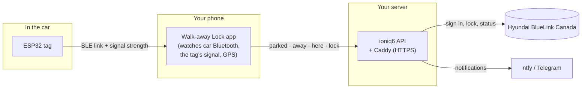
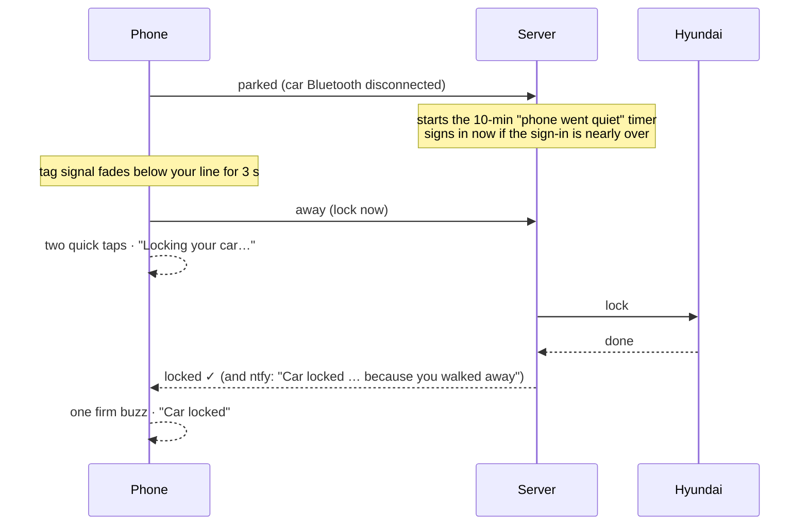

# How it works

## The pieces

- **The tag** just stays connectable over Bluetooth LE. No Wi-Fi, no logic.
- **The app** decides. It's the thing that walks away with you, and it always has internet.
- **The server** holds your BlueLink login, talks to Hyundai, confirms results, and runs safety
  nets that work even if the phone doesn't.

## A normal walk-away

## How the app decides

| Situation | What happens |
|---|---|
| Car Bluetooth connects | **Driving.** Any pending lock is cancelled. |
| Car Bluetooth disconnects | **Parked.** Tells the server, and looks for the tag (it has often just booted). |
| Tag signal below your line for 3 s, or the link drops after fading | **Away:** the server locks right away. |
| Tag link drops while the signal was still strong | Treated as the tag **losing power** (e.g. you started the car), never as a walk-away. If the car's Bluetooth doesn't connect within 90 s, the server checks the car and locks only if it's off. |
| First 10 s after parking | Tag hiccups are ignored. |
| Tag not found within 45 s of parking | Falls back to car Bluetooth only, with the server's grace period. |
| Back near the car for 30 s without driving | Re-arms, so leaving again locks again. |
| Parked at home | Home mode: one lock per visit (see [Calibrate and use](4-using.md#home-mode)). |
| No network when you walk away | Retries with back-off for several minutes and shows an alert. |

A lock is always a plain **lock** command: locking a car that's already locked is harmless, while
checking first would mean waking the car each time, which Hyundai limits.

## Safety nets on the server

- **Phone went quiet.** After "parked", the phone checks in every couple of minutes while it's near
  the car. If it goes silent for 10 minutes without a lock (dead battery, no signal, app killed),
  the server locks.
- **Backup check.** Every 6 hours it reads Hyundai's *saved* status (no car wake-up). If the car
  is off and unlocked on two checks, it locks after a 60-second cancel window. It skips the check
  after a confirmed lock, or when the phone said it was at the car in the last 15 minutes.
- **Open doors.** If a lock is refused because something's open, it tells you which, re-checks
  every 30 s and locks once it's closed, or sends a high-priority alert after 5 tries.

## Staying under Hyundai's limits

Hyundai's API sits behind Cloudflare, which blocks an IP for a while if it **signs in** too often,
and Hyundai limits how often the **car is woken** per day. The server:

- signs in only when a request needs it; never runs two sign-ins at once; never signs in again
  within 2 minutes (except for a lock); and signs in ahead when you park, so the walk-away lock
  doesn't wait for one
- serves app opens from a 30-minute cache of Hyundai's *saved* status, which doesn't wake the car
- allows at most 4 automatic car wake-ups a day, none overnight (your own taps always go through)
- on a refusal, backs off with growing pauses; a lock gets a shorter pause and keeps retrying for
  up to 45 minutes

## Tokens

The installer makes two random passwords:

- **Phone token:** read status, **lock**, and drive auto-lock. It **can't** unlock, start climate
  or read the car's location, so a lost phone or a leaked automation can't open the car.
- **Admin token:** everything. Only needed in the app for Unlock, Climate, Charging and Find car.

Ten wrong tokens from one IP lock that IP out for 15 minutes.
